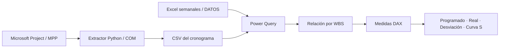

<p align="center"><strong>INGENIERÍA · BUSINESS INTELLIGENCE · CONTROL DE OBRA</strong></p>

# Avance programado vs. real · Curva S

**Conectar el cronograma con lo que realmente ocurre en obra.** Proyecto de Power BI que integra la línea base de Microsoft Project con reportes semanales de ejecución para comparar avance, identificar desviaciones y revisar actividades.


**Power BI · DAX · Power Query · Microsoft Project · Python · Excel**

[Explorar el reporte](powerbi/) · [Entender las métricas](docs/METRICAS.md) · [Preparar la demo](#explora-el-proyecto) · [Proyecto complementario: Cortes de obra](https://github.com/loyal5889/automatizacion-cortes-de-obra)

> La imagen es una ilustración del caso de uso con datos sintéticos; no es una captura del dashboard operativo. Aquí se publica la definición editable del reporte y del modelo, sin los datos de la obra original.

## La pregunta que resuelve

**¿Cuánto deberíamos haber avanzado a una fecha y cuánto hemos ejecutado realmente?** Un cronograma aislado describe el plan. Los reportes de campo describen cantidades. El modelo vincula ambos por WBS para comparar sus aportes y localizar desviaciones.

## Qué contiene

| Vista / componente | Propósito |
|---|---|
| Avance programado | Seguir el plan a partir de fechas y duración de línea base |
| Avance real | Consultar cantidades ejecutadas y su aporte al avance |
| Desviación | Contrastar lo programado con lo real por actividad |
| Curva S | Observar la evolución del avance en el tiempo |
| Extractor Python | Exportar tareas de Microsoft Project a un CSV de estructura estable |
| Modelo TMDL | Hacer revisables las medidas DAX, relaciones y consultas |

## Arquitectura



## Explora el proyecto

### 1. Revisar sin instalar Power BI

- [Reporte PBIR](powerbi/DARCA%202%20AGENTE.Report/definition/): páginas y visuales.
- [Modelo semántico TMDL](powerbi/DARCA%202%20AGENTE.SemanticModel/definition/): tablas, relaciones y medidas.
- [Extractor de Microsoft Project](src/extractor_project.py): lectura COM y salida CSV.
- [Métricas y supuestos](docs/METRICAS.md): definición de avance y limitaciones de interpretación.

### 2. Generar fuentes ficticias

```bash
git clone https://github.com/loyal5889/dashboard-avance-programado-vs-real-curva-s.git
cd dashboard-avance-programado-vs-real-curva-s
python -m pip install -r requirements.txt
python scripts/crear_demo.py
```

Se crean `data/demo/output/cronograma_darca2.csv` y cuatro reportes en `data/demo/avance_real/`. Contienen seis actividades ficticias, con 100 m² cada una y avances semanales de 10, 20, 25 y 15 m². El script no sobrescribe fuentes existentes.

### 3. Abrir en Power BI Desktop

1. Use una versión de Power BI Desktop compatible con proyectos PBIP y definiciones PBIR/TMDL.
2. Las rutas de la edición pública apuntan a **`C:\Datos\Demo`**. Copie allí las carpetas `output` y `avance_real` generadas, o ajuste las rutas de las consultas en su copia del modelo.
3. Abra `powerbi/DARCA 2 AGENTE.pbip` y actualice las fuentes locales.
4. Revise la fecha de evaluación: algunas medidas usan `TODAY()` y la demo tiene fechas fijas de enero/febrero de 2026. El resultado depende del contexto temporal seleccionado.

La actualización y la visualización requieren Power BI Desktop. Esta edición no incluye un PBIX con datos precargados ni un enlace público a Power BI Service. No se ha certificado una actualización del modelo público en todos los entornos de Desktop.

### 4. Conectar un cronograma propio

El extractor requiere **Windows, Microsoft Project Desktop y pywin32**. Coloque un único MPP en `input/` y ejecute:

```bash
python src/extractor_project.py
```

El resultado se escribe en `output/cronograma_darca2.csv`. Las fechas y duraciones de línea base deben existir; el extractor no crea un cronograma ni modifica el MPP. Los nombres internos `darca2` se conservan como identificadores técnicos del modelo original.

## Mi trabajo en este proyecto

- Integración de cronograma y registros de campo mediante WBS.
- Extracción automatizada con Python y el modelo COM de Microsoft Project.
- Transformación de fuentes con Power Query y modelado de avance en DAX.
- Separación de vistas de plan, ejecución y desviaciones para la revisión de obra.
- Publicación de definiciones editables para que las reglas puedan consultarse.

## Qué demuestra

Un flujo reproducible de preparación de datos, integración de fuentes y análisis de avance. No se atribuyen ahorros o mejoras porcentuales que no hayan sido medidos. Las cantidades de distinta unidad no se suman como si fueran equivalentes: las medidas deben interpretarse por actividad y por su ponderación.

**Autor:** [loyal5889](https://github.com/loyal5889) · [Explorar la automatización de cortes](https://github.com/loyal5889/automatizacion-cortes-de-obra)
