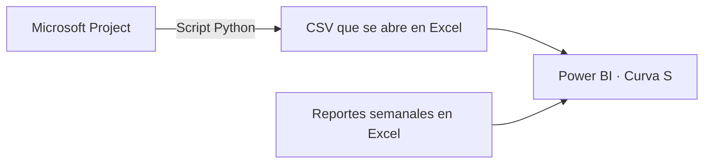

# Avance programado vs. real · Curva S · DARCA II

Conecté la programación de **Microsoft Project** con los reportes de avance de obra para comparar lo programado con lo ejecutado en **Power BI**.



## Cómo funciona

1. **Project:** preparo el cronograma con las actividades, fechas, duraciones y línea base.
2. **Python → Excel:** el script extrae la información de Project a un archivo CSV, que puedo consultar en Excel. La salida del script es `.csv`, no `.xlsx`.
3. **Power BI:** conecto el cronograma y los reportes semanales de ejecución mediante el código WBS. Con esa información comparo el avance programado con el real y sus desviaciones.

## El script de extracción

[Ver el script Python utilizado](src/extractor_project.py)

Lee un archivo `.mpp` y genera `output/cronograma_darca2.csv` con las tareas y sus datos de programación.

Para ejecutarlo se necesita Windows, Microsoft Project instalado y Python. Coloca un único archivo `.mpp` en una carpeta `input/` junto a `src/` y ejecuta:

```powershell
python -m pip install -r requirements.txt
python src/extractor_project.py
```

**Herramientas:** Microsoft Project · Python · Excel · Power BI · DAX.

[Ver también: automatización de cortes de obra](https://github.com/loyal5889/automatizacion-cortes-de-obra)
