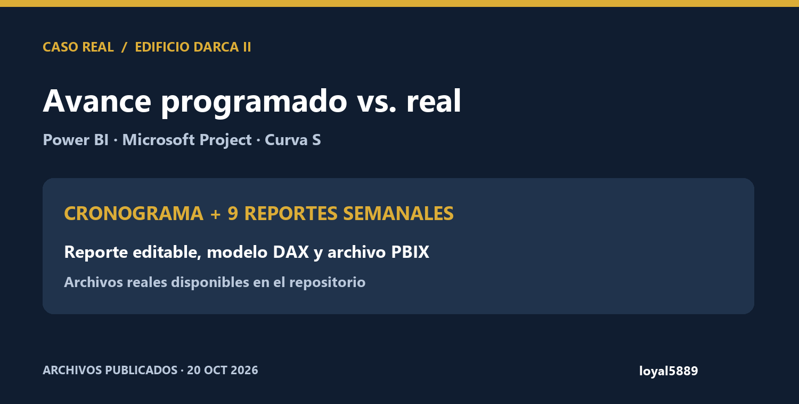
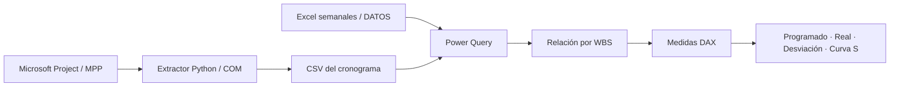

<p align="center"><strong>INGENIERÍA · BUSINESS INTELLIGENCE · CONTROL DE OBRA</strong></p>

# Avance programado vs. real · Curva S

**Conectar el cronograma con lo que realmente ocurre en obra.** Proyecto de Power BI que integra la línea base de Microsoft Project con reportes semanales de ejecución para comparar avance, identificar desviaciones y revisar actividades.



**Power BI · DAX · Power Query · Microsoft Project · Python · Excel**

[Explorar el reporte](powerbi/) · [Entender las métricas](docs/METRICAS.md) · [Archivos reales](#explora-el-proyecto) · [Proyecto complementario: Cortes de obra](https://github.com/loyal5889/automatizacion-cortes-de-obra)

> Caso real de **DARCA II**: se incluyen el cronograma, nueve reportes semanales y el PBIX disponible al 20 de octubre de 2026. La portada es una presentación del proyecto, no una captura del tablero.

## La pregunta que resuelve

**¿Cuánto deberíamos haber avanzado a una fecha y cuánto hemos ejecutado realmente?** Un cronograma aislado describe el plan. Los reportes de campo describen cantidades. El modelo vincula ambos por WBS para comparar sus aportes y localizar desviaciones.

## Qué contiene

| Vista / componente | Propósito |
|---|---|
| Avance programado | Seguir el plan a partir de fechas y duración de línea base |
| Avance real | Consultar cantidades ejecutadas y su aporte al avance |
| Desviación | Contrastar lo programado con lo real por actividad |
| Curva S | Observar la evolución del avance en el tiempo |
| Extractor Python | Exportar tareas de Microsoft Project a un CSV de estructura estable |
| Modelo TMDL | Hacer revisables las medidas DAX, relaciones y consultas |

## Arquitectura



## Explora el proyecto

### 1. Revisar sin instalar Power BI

- [Reporte PBIR](powerbi/DARCA%202%20AGENTE.Report/definition/): páginas y visuales.
- [Modelo semántico TMDL](powerbi/DARCA%202%20AGENTE.SemanticModel/definition/): tablas, relaciones y medidas.
- [Extractor de Microsoft Project](src/extractor_project.py): lectura COM y salida CSV.
- [Métricas y supuestos](docs/METRICAS.md): definición de avance y limitaciones de interpretación.

### 2. Consultar los archivos reales

- [Cronograma exportado de Project](fuentes_darca/cronograma/cronograma_darca2.csv).
- [Nueve reportes semanales de DARCA II](fuentes_darca/reportes/).
- [Descargar el PBIX existente](powerbi/DARCA%202%20TABLERO%20AVANCE.pbix).

Se conserva el contenido original de estos archivos. El PBIX es una copia del archivo guardado; no se ha actualizado ni certificado que sus datos internos incluyan todos los reportes publicados. Los nombres semanales pueden abarcar días posteriores a la fecha de publicación: revise las fechas y cantidades registradas en la hoja DATOS.

### 3. Abrir en Power BI Desktop

1. Para consultar el archivo guardado, abra el PBIX en Power BI Desktop.
2. Para trabajar con la definición editable, abra `powerbi/DARCA 2 AGENTE.pbip` con una versión compatible con PBIP y PBIR/TMDL.
3. Configure las fuentes de su copia para leer `fuentes_darca/cronograma/cronograma_darca2.csv` y `fuentes_darca/reportes/`. La definición pública conserva la ruta de instalación `C:\Datos\Demo`: alternativamente, copie el CSV a `C:\Datos\Demo\output` y los reportes a `C:\Datos\Demo\avance_real`. El nombre de esa ruta no implica datos ficticios.
4. Actualice localmente y revise el contexto de fecha: algunas medidas usan `TODAY()`.

No se ha realizado una actualización del modelo en Desktop durante esta publicación. No hay un tablero interactivo alojado en Power BI Service.

### 4. Conectar un cronograma propio

El extractor requiere **Windows, Microsoft Project Desktop y pywin32**. Coloque un único MPP en `input/` y ejecute:

```bash
python src/extractor_project.py
```

El resultado se escribe en `output/cronograma_darca2.csv`. Las fechas y duraciones de línea base deben existir; el extractor no crea un cronograma ni modifica el MPP. Los nombres internos `darca2` se conservan como identificadores técnicos del modelo original.

## Mi trabajo en este proyecto

- Integración de cronograma y registros de campo mediante WBS.
- Extracción automatizada con Python y el modelo COM de Microsoft Project.
- Transformación de fuentes con Power Query y modelado de avance en DAX.
- Separación de vistas de plan, ejecución y desviaciones para la revisión de obra.
- Publicación de definiciones editables para que las reglas puedan consultarse.

## Qué demuestra

Un flujo reproducible de preparación de datos, integración de fuentes y análisis de avance. No se atribuyen ahorros o mejoras porcentuales que no hayan sido medidos. Las cantidades de distinta unidad no se suman como si fueran equivalentes: las medidas deben interpretarse por actividad y por su ponderación.

**Autor:** [loyal5889](https://github.com/loyal5889) · [Explorar la automatización de cortes](https://github.com/loyal5889/automatizacion-cortes-de-obra)
